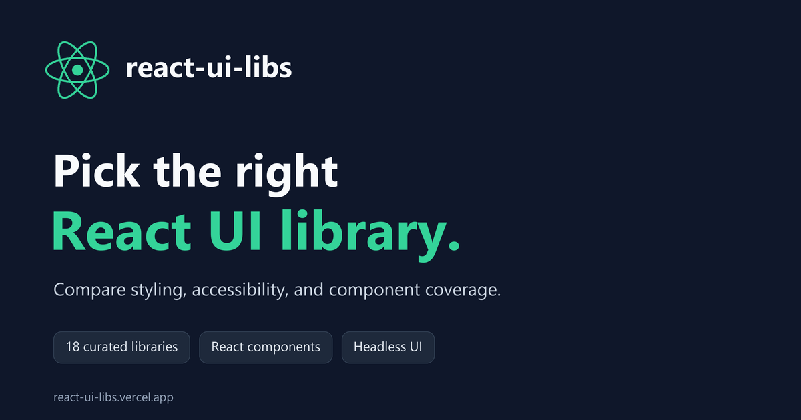

# react-ui-libs

Compare popular React UI libraries by styling, accessibility, component coverage,
and package or source distribution. Pick the right UI library for your React or
Next.js project.

[Visit the website](https://react-ui-libs.vercel.app/) ·
[GitHub repository](https://github.com/BINGWU2003/react-ui-libs)



## Included libraries

| Library               | Official website                                               | Primary npm package          |
| --------------------- | -------------------------------------------------------------- | ---------------------------- |
| Ant Design            | [ant.design](https://ant.design)                               | `antd`                       |
| MUI                   | [mui.com](https://mui.com/material-ui/)                        | `@mui/material`              |
| shadcn/ui             | [ui.shadcn.com](https://ui.shadcn.com)                         | `shadcn` (CLI)               |
| Mantine               | [mantine.dev](https://mantine.dev)                             | `@mantine/core`              |
| Chakra UI             | [chakra-ui.com](https://chakra-ui.com)                         | `@chakra-ui/react`           |
| HeroUI                | [heroui.com](https://heroui.com)                               | `@heroui/react`              |
| PrimeReact            | [primereact.dev](https://primereact.dev)                       | `primereact`                 |
| React Bootstrap       | [react-bootstrap.github.io](https://react-bootstrap.github.io) | `react-bootstrap`            |
| Fluent UI             | [react.fluentui.dev](https://react.fluentui.dev)               | `@fluentui/react-components` |
| Arco Design           | [arco.design](https://arco.design/react/en-US/docs/start)      | `@arco-design/web-react`     |
| React Suite           | [rsuitejs.com](https://www.rsuitejs.com)                       | `rsuite`                     |
| Radix Themes          | [radix-ui.com/themes](https://www.radix-ui.com/themes)         | `@radix-ui/themes`           |
| Flowbite React        | [flowbite-react.com](https://flowbite-react.com)               | `flowbite-react`             |
| Radix Primitives      | [radix-ui.com/primitives](https://www.radix-ui.com/primitives) | `radix-ui`                   |
| Headless UI           | [headlessui.com](https://headlessui.com)                       | `@headlessui/react`          |
| React Aria Components | [react-aria.adobe.com](https://react-aria.adobe.com)           | `react-aria-components`      |
| Ark UI                | [ark-ui.com](https://ark-ui.com)                               | `@ark-ui/react`              |
| Base UI               | [base-ui.com](https://base-ui.com)                             | `@base-ui/react`             |

This is a curated selection of web UI libraries, not a complete list of the React
ecosystem. Standalone charting, table, form, animation, and React Native libraries
are outside this catalog.

## Using the picker

- Hover a feature to read its definition, then select features to filter libraries.
- Multiple selected features must all match. Styled/Unstyled and Package/Copy & Paste are mutually exclusive filter selections. A library supporting both styling modes can match either.
- Use the range controls to set minimum repository stars, weekly npm downloads,
  or matched component categories. Clear the filters to reset the list.
- Open a library's component drawer to see available and missing categories.
- On smaller screens, open the filter sidebar using the menu button.

### How to interpret the data

Component counts represent categories in this catalog, **not the total number of
components or exports advertised by a library**. Equivalent names are normalized,
such as Dialog → Modal, Drawer → Slideover, and Switch → Toggle. Official free
companion packages may be included; paid extensions and third-party examples are
not counted as built-in components. Consult each library's documentation for exact
APIs, package requirements, and framework compatibility.

**Free Core** means the listed core components can be used commercially without
revenue or team-size eligibility limits. Premium templates, extensions, design
kits, and support may still cost money.

**Accessibility** indicates documented accessibility support, not certification
of every component or application. Unstyled libraries still require appropriate
styling and integration. Figma resources may be paid separately.

Repository stars load through a same-origin endpoint, with an hourly server cache
shared across visitors. If the GitHub API is unavailable or rate-limited, the
server reads the exact star count from the official GitHub repository page.
The stars slider shows a loading or error state until data is available.
Weekly npm downloads load in the browser from npm.
Stars may cover an entire monorepo, including other products or frameworks.
Downloads refer to the one named package, not all packages in its ecosystem.
For shadcn/ui, downloads come from the [`shadcn` npm package](https://www.npmjs.com/package/shadcn)
and measure CLI downloads, not component installs. They are displayed and used by
the download filter. These metrics are not directly comparable usage rankings.
Unavailable metrics stay hidden and do not pass an active metric filter. A zero
threshold leaves libraries visible even when the API is unavailable.

Catalog reviewed on **2026-10-29**. Libraries change; verify important requirements
against their official documentation before choosing one.

## Development

The website itself uses **Nuxt 3, Vue, Nuxt UI, and Tailwind CSS**. React libraries
are catalog entries with links and metadata; they are not installed or rendered
inside the application. No database is required.

Use Node.js 22.6 or newer. The Dev Container includes Node.js 22.

```sh
npm ci
npm run dev
```

The development server normally runs at `http://localhost:3000`.

```sh
npm test
npm run build
npm run preview
```

### Site URL and Vercel

The production site is [react-ui-libs.vercel.app](https://react-ui-libs.vercel.app/).
The Nuxt configuration uses this URL by default. Set `NUXT_PUBLIC_SITE_URL` in a
local `.env` file or in Vercel's environment variables to override the canonical
and social sharing URLs for another deployment. See `.env.example`.

An explicitly empty or invalid URL omits canonical and absolute OG/Twitter image
metadata. The project includes no advertising or analytics scripts.

## Contributing

Update `data/libraries.ts` for library metadata and component coverage,
`data/filters.ts` for feature definitions, and `data/sections.ts` for the shared
component taxonomy. Use official documentation as the source, avoid duplicate
component mappings, and do not infer library support merely from a third-party
example. Store logos locally in `public/img/`; source references are listed in
that directory's README.

Run `npm test` and `npm run build` before submitting changes.

## Credits and license

Adapted from [David Dahan's UI Lib Picker](https://github.com/ddahan/ui-libs).
The original project is licensed under MIT; its copyright notice is retained in
[LICENSE](LICENSE). Library names and logos belong to their respective owners.
Logo assets retain their upstream licenses and trademark terms.

The catalog is provided as a selection aid. Information may become outdated or
contain omissions; refer to the official projects for authoritative details.
